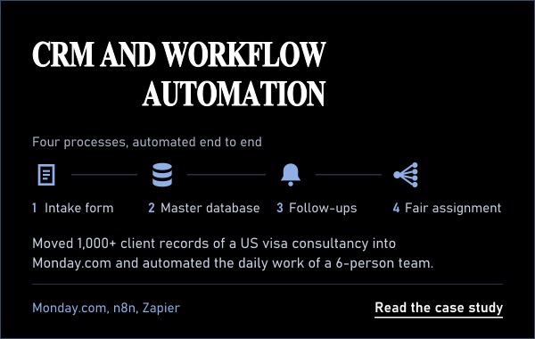

<p align="center">
  
</p>

## Hi, I'm Ivan

I'm a data analyst who turns messy business data into dashboards, models and automations that people actually use. I'm finishing a B.Sc. in Data Science & AI and work as a freelance analyst.

My latest client project: I moved a visa consultancy's **1,000+ client records** into a CRM and automated its intake, follow-ups and case assignment for a 6-person team.

**Open to remote** Data Analyst, BI and automation roles (full-time, contract or internship). Based in Mexico (UTC-6), with full overlap with US and Canadian teams.

```python
ivan = {
    "role":      "Data Analyst",
    "based_in":  "Xalapa, Mexico (UTC-6), working remotely",
    "studying":  "B.Sc. Data Science & AI, IEU (Dec 2027)",
    "good_at":   ["SQL", "Python", "Power BI", "predictive models", "n8n", "Zapier"],
    "languages": {"English": "C1", "Spanish": "native"},
    "currently": "building a Power BI dashboard on churn risk scores",
}
```

## Connect with me

<p align="center">
  <a href="mailto:ivanignacio143@gmail.com"></a>
  <a href="https://www.linkedin.com/in/ivan-ignacio-velazquez-b436362b6/"></a>
  <a href="https://imivyzz.github.io"></a>
</p>

## Toolkit

<p align="center">
  
</p>

## Featured work

<p align="center">
  <a href="https://github.com/ImIvyzz/telco-churn"></a>
  <a href="https://imivyzz.github.io"></a>
</p>

<details>
<summary><b>Telco churn: what's inside the repo</b></summary>
<br>

- Cleaned and explored 7,043 customers: churners are 26.5% of customers and 30.5% of monthly revenue.
- Chi-square tests to separate real drivers (contract, tech support, payment method) from noise (gender and phone service show no effect).
- scikit-learn pipeline with a baseline, logistic regression and random forest, compared with 5-fold cross-validation.
- Risk scores for every customer, ready for a CRM or a BI dashboard.
- A 14-slide business presentation with the findings and four recommended actions.

</details>

<details>
<summary><b>CRM automation: what I built</b></summary>
<br>

- Implemented a Monday.com CRM and migrated 1,000+ client records into one master database with each client's full history.
- Built n8n and Zapier workflows for client intake, database organization, automated follow-ups and reminders.
- Replaced manual case assignment with a balanced round-robin across 4 advisors.

</details>

## Background

- 🎓 **B.Sc. Data Science & Artificial Intelligence**, IEU University, Mexico (expected Dec 2027)
- 🍁 **Diploma in Data Analytics (co-op)**, Toronto School of Management, Canada (2023–2024)
- 📊 **Diploma in Power BI, AI Tools & BI**, Cámara de Comercio Exterior (2026, in progress)
